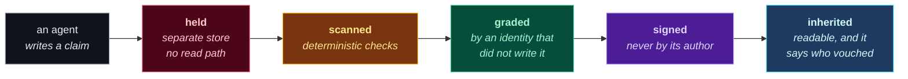

**A company's agents relearn the same lessons. Keep the ones a reviewer checked.**

---

## The problem

Every engineer teaches their agent how the work is actually done — a naming convention, a
deployment constraint, the way round a broken API. Today that knowledge sits on one laptop,
or gets copied between machines with nobody vouching for it.

Two findings, and the second is why the obvious fix does not work.

**The knowledge dies in one session.** A field experiment across **66 firms** found individual
AI time savings with **no shift in the quantity or composition of work** at the organizational
level. The gains stay single-player.

**Pooling it pools the mistakes at the same speed.** Across **fourteen memory providers**
surveyed, not one holds a claim back pending review. Confidence scores and decay change
*ranking*, never *visibility* — so a wrong belief is a slightly lower-ranked wrong belief,
still readable, still actionable, forever.

So the useful thing and the dangerous thing are the same thing: shared agent memory. The
question is what gets in.

## What doublegate does

It is **admission control for agent memory**. Nothing an agent writes becomes readable to
anyone else until a reviewer that did not write it has signed it. What survives that review
reaches every colleague's agent, carrying who taught it and who approved it.

The reviewer is never the author. That is not an invention here — the ECB names the
**four-eyes principle** for overrides and sign-offs in its own words. doublegate implements it
mechanically, on a write path, for machines.

The name is the architecture: a second, independent gate countersigns what the first one
signed. One gate runs today; the second returns as a peer on the SDK.

Every other memory system treats a write as a fact. This one treats it as a **claim**.

## Where a memory lives, and what comes back

Review is the part people expect. The part that makes it usable is the shape underneath.

**A memory is written into a work area**, which is a path — `claude/7b8/fetch`. Recall starts
at the area it was given and walks up: that area, then its parent, then its parent, stopping
at the first level that holds a promoted claim.

Three consequences, and they are the reason for the shape:

- A subagent's findings stay the subagent's until something promotes them.
- A sibling area is never searched. A caller that wants everything asks for the whole space.
- Distance is reported and never used as a weight. A hit says it came from one level up, and
  that changes nothing about the order.

**Steering is a direction a person writes to a place in that hierarchy.** It is reviewed like
any other claim, then returned on every recall along that path — first, apart from the ranked
results, whatever the query asked for. It is never a ranked hit, so it cannot be out-ranked,
because it never competes.

**Every row names its producer**, so a session's lineage draws as a tree: the session's area,
the subagents' areas beneath it, and who wrote how many rows in each. "Which agent learned
this, and from where" resolves to a record.

**A crew is a space of its own** — several agent sessions working to a charter a reviewer
signed, each under an API key of its own, started by a runner that sits outside the gate and
signs and promotes nothing. What one crew draws from another is a read an administrator
granted, counted and recorded as derived from it. Crews run; how well they work is unmeasured.

[See all three in one figure](https://about.doublegate.io/how-it-works.html)

## What it costs to run

It replaces a memory provider rather than sitting in front of one: a read boundary the gate
does not own cannot be enforced, so wrapping an existing provider was considered and rejected. An agent
speaks the interface it already speaks, and one thing changes, which is what gets in.

| | |
|---|---|
| **Read latency** | unchanged — the gate is not in the query path at all |
| **Write latency** | fire-and-forget, target under 50 ms; review runs in a background loop, so a slow reviewer never blocks an agent |
| **Tokens** | **a real new cost.** Grading calls a model, and the system is required to report that spend rather than hide it |
| **Visibility** | a claim is not readable by others the instant it is written. That gap is the review, and it shrinks rather than disappearing |
| **What's reviewed** | claims only. Transcripts, tool output and logs pass straight through as records |
| **Runtime** | Python 3.11+, one dependency in the core. It runs beside the agent, and the plugin keeps working when the gate is down |

An agent gains tools to write and to read — `remember`, `record`, `recall`, `workarea`,
`lineage`, `complete`, `status` — and gains no way to approve its own writing. **There is no
promote, sign or delete tool on any tier, over any transport:** the thing being gated does not
operate the gate. Identity comes off the connection, so an agent cannot claim to be someone
else.

## Try it

| | |
|---|---|
| [**doublegate-sdk**](https://github.com/doublegate-io/doublegate-sdk) | public today. The gate contracts and a connected client, zero dependencies. Checks a declarative manifest and runs bounded literal checks offline, with no gate running |
| [**The site**](https://about.doublegate.io) | the argument, the mechanism and the evidence, with every claim carrying its source |
| [**Evidence**](https://about.doublegate.io/evidence.html) | the findings, including the ones that cut against the design |

The gate, the console, the Claude Code plugin and the peers open with the first release.

## How this organization is laid out

One workspace, eleven packages, one dependency direction that never reverses.

| | | |
|---|---|---|
| [**doublegate-sdk**](https://github.com/doublegate-io/doublegate-sdk) | the gate contracts and a connected client, zero dependencies — everything else composes through it | public |
| **client-gate** | the gate on a machine: holds, scans, grades, signs, and serves recall | opens at release |
| **doublegate-agent** | the Claude Code plugin: the agent's tools, evidence hooks, skills and a librarian, over the SDK alone | opens at release |
| **doublegate-peers** | programs that run beside the gate under keys of their own: a notifier, a skill watcher, the runner that starts a crew | opens at release |
| **doublegate-ui** | the console's presentation primitives | opens at release |
| **design** | the specification: requirements, architecture, decision records, research, roadmap | private |
| [**doublegate-io.github.io**](https://github.com/doublegate-io/doublegate-io.github.io) | the site — static HTML, no build dependency beyond Python 3 | public |
| [**.github**](https://github.com/doublegate-io/.github) | this profile, and the org-wide policies | public |

The organization gate and the crawler are archived: the second authority returns as a peer on
the SDK rather than as a seam inside the library, and the gate's surface names no other
service.

## Where it is going

Running today on one machine: one gate, its console, a Claude Code plugin and the offline SDK.

| | |
|---|---|
| **Next** | the Solo release — installable, backed up and restorable, with rotating signing keys and erasable content |
| **Then** | Team — one gate a group shares over the network, under one review policy |
| **Later** | a second, independent gate that countersigns a promotion and lifts its provisional mark |

Each step is sequenced on the [public roadmap](https://about.doublegate.io/for-engineers.html),
and the hard problems each carry a recorded decision: erasure settled by crypto-shredding, so
append-only history and the right to be forgotten both hold; per-space grants enforced on every
transport today, with the console's own grant screen to follow; and no accuracy number shipping
ahead of its measurement.

Where code and design disagree, the design wins and the code is the bug.

## Who this is for

| Reader | The question | Start here |
|---|---|---|
| **An engineer** evaluating a memory provider | What does it cost, and what breaks? | [For engineers](https://about.doublegate.io/for-engineers.html) |
| **A platform or infrastructure lead** | How is knowledge shared without sharing mistakes? | [For business](https://about.doublegate.io/for-business.html) |
| **Security, risk or audit** | Who approved this, and can it be proven later? | [Governance](https://about.doublegate.io/governance.html) |
| **A sceptic** | Is any of this actually true? | [Evidence](https://about.doublegate.io/evidence.html) |

## Talk

- **Deployment, pricing, or whether it fits a given team** — [email](mailto:eugene@doublegate.io?subject=doublegate%20—%20deployment%20and%20pricing)
- **An investor conversation** — [email](mailto:eugene@doublegate.io?subject=doublegate%20—%20investors)
- **An objection, a correction, or a citation that is wrong** — [open an issue](https://github.com/doublegate-io/doublegate-io.github.io/issues).
  A correction to the evidence page is the most useful thing anyone can send.
- **A vulnerability** — see [SECURITY.md](https://github.com/doublegate-io/.github/blob/main/SECURITY.md). Do not open a public issue.
- **Anything else** — [SUPPORT.md](https://github.com/doublegate-io/.github/blob/main/SUPPORT.md) says where each kind of question goes.

### Read the whole argument

[**How it works**](https://about.doublegate.io/how-it-works.html) ·
[**For business**](https://about.doublegate.io/for-business.html) ·
[**For engineers**](https://about.doublegate.io/for-engineers.html) ·
[**Governance**](https://about.doublegate.io/governance.html) ·
[**Pricing**](https://about.doublegate.io/pricing.html) ·
[**Evidence**](https://about.doublegate.io/evidence.html)

Every number on this page is traceable to a primary source on the evidence page, including the findings that cut against the design.

